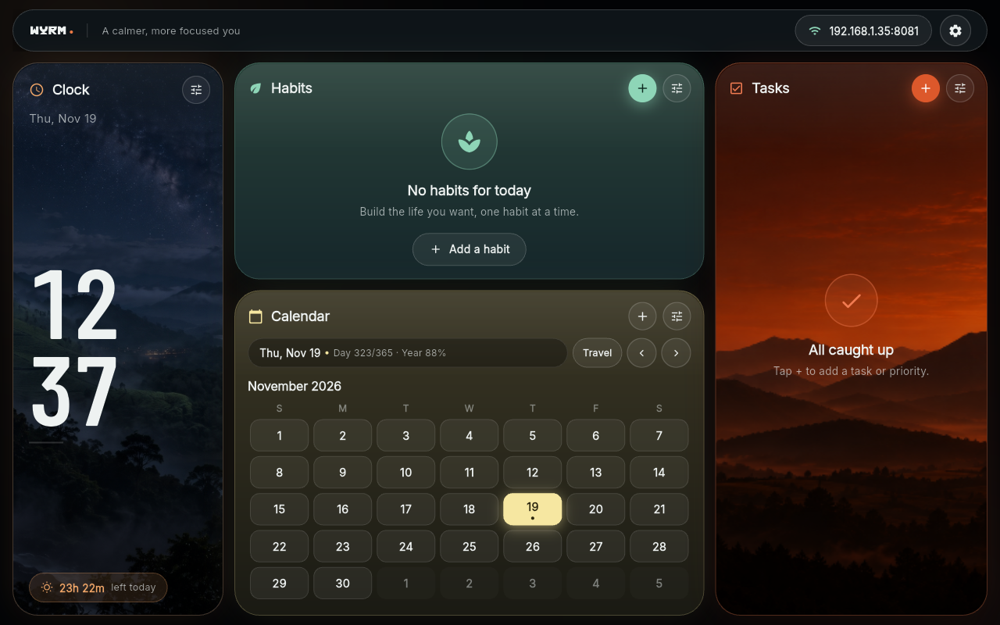
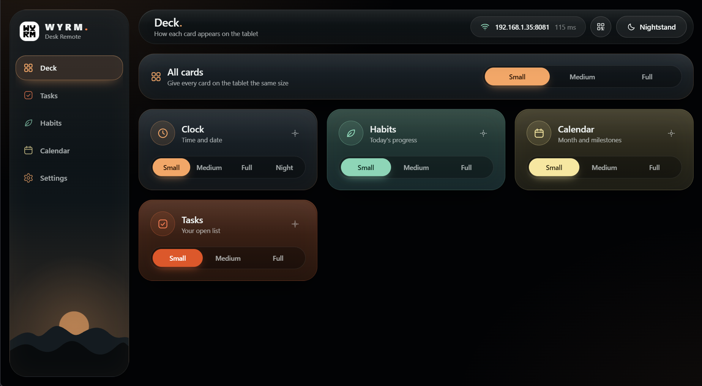

# Wyrm Desk

**Turn any Android tablet into an ambient desk companion and smart dashboard.**

 

[**Download Latest APK**](https://github.com/jydv402/wyrm_app/releases/latest) • [**Screenshots**](#-interface-showcase) • [**Features**](#-features) • [**Quick Start**](#-quick-start) • [**Architecture**](#-under-the-hood)

 

---

## ✦ What is Wyrm Desk?

Have an older Android tablet sitting in a drawer? **Wyrm Desk** breathes new life into it by turning it into a dedicated landscape desk companion. 

It serves as a live dashboard for your time, habits, calendar, and daily focus.

Best of all, **your tablet is also a local server**. Without installing any apps on your phone or laptop, you can wirelessly control and update your tablet dashboard from any web browser on your Wi-Fi network.

---

## ✦ Interface Showcase

### Tablet Ambient Dashboard
*A dedicated landscape display featuring a live dynamic clock, habit contribution heatmap, calendar countdown milestones, and priority checklist.*

 

### Browser Web Remote Companion
*A zero-install companion interface hosted directly by the tablet for wireless management from any phone or laptop on your Wi-Fi network.*

---

## ✦ Features

### ⏱️ Dynamic Clock & Bedtime Nightstand
- **Multiple Clock Faces:** Clean digital clock with Barlow Condensed typography, discrete analogue instrument dial, or dynamic photographic backdrops.
- **Daylight Photography Drift:** The clock backdrop subtly shifts throughout the day (morning fog, daytime warmth, golden hour, and midnight calm).
- **Nightstand Mode:** Switch to an ultra-low glare, pitch-black amber display with a single tap for bedside nightstand duty.
- **Civil Day Countdown:** A live countdown pill tracks the hours and minutes remaining today.

### 🌿 Daily Habits with Heatmap Matrix
- **GitHub-Style Heatmap:** Visualize consistency across the entire month with a 7-row weekday contribution matrix.
- **Streak Counters:** Track active daily streaks and completion momentum at a glance.
- **One-Tap Stepping:** Check off habits or step multi-count goals directly from the tablet or remotely.

### 📅 Calendar & Countdown Milestones
- **Interactive Month View:** Fluid month browsing with configurable week start (Monday vs. Sunday).
- **Countdown Milestones:** Pin high-priority deadlines, trips, and milestones with live days-remaining badges.
- **Year & Quarter Progress:** Glanceable fraction indicators show current progress through the quarter and year.

### ⚡ Priority Task Checklist
- **Three-Tier Priority System:** Color-coded tasks with dedicated `HIGH`, `MED`, and `LOW` priority tags.
- **Tactile Checkbox Animations:** Satisfying tactile completion with instant visual feedback.

### 📡 Zero-Install Web Remote Companion
- **Control from Any Browser:** The tablet hosts an embedded HTTP + WebSocket server (`shelf`) on your local Wi-Fi.
- **Instant QR Pairing:** Tap the Wi-Fi pill on your tablet, scan the QR code with your phone or laptop camera, and start adding tasks or marking habits instantly.
- **Live Bidirectional Sync:** Mutations from your phone reflect on the tablet in real time with sub-millisecond local latency.

### 🔒 100% Offline-First & Private
- **Zero Cloud, Zero Accounts:** All data remains strictly on your device inside an offline JSON document store.
- **Easy Backups:** One-tap export and import directly to your tablet's `Downloads` folder, or backup wirelessly from your computer via the Web Remote.

### 🔄 In-App Update Engine
- **Effortless Upgrades:** Built-in update checker queries GitHub Releases with architecture-specific APK downloads.
- **Automated Hourly Checks:** Reuses the live clock stream to check for new versions quietly once an hour (with automatic suppression during Nightstand Mode to prevent nighttime glare).
- **Update Dialog:** View full Markdown release notes and jump directly to download with one tap.

---

## ✦ Quick Start

Get your tablet running in two simple steps:

1. **Install Wyrm Desk on your tablet:**
   - Grab the appropriate APK from the [**Releases Page**](https://github.com/jydv402/wyrm_app/releases/latest):
     - `arm64-v8a`: Most modern tablets (64-bit ARM). Recommended for almost all devices from 2016 onward.
     - `armeabi-v7a`: Older budget or legacy tablets (32-bit ARM, including older Amazon Fire tablets).
     - `x86_64`: Intel or AMD-based devices, ChromeOS, and desktop Android emulators.
     - `universal`: Combined build that works on any device. Choose this if you are unsure about your tablet's processor.
   - Sideload and launch the app on your Android tablet (Android 7.0+ recommended).

2. **Connect your phone or laptop:**
   - Make sure your phone/laptop is on the same Wi-Fi network as the tablet.
   - Tap the **Wi-Fi status pill** on the top navigation bar of the tablet to open the Web Remote modal.
   - Scan the QR code with your phone camera or visit `http://<tablet-ip>:8081` in your browser.
   - You can now create tasks, track habits, and control your tablet dashboard remotely.

---

## ✦ Under the Hood

| Area | Technology |
|---|---|
| **Framework** | [Flutter](https://flutter.dev) (Dart 3.x, Material 3 Dark) |
| **State Management** | [Flutter Riverpod](https://riverpod.dev) v3 (`Notifier`, `ProviderScope`) |
| **Local Remote Server** | [Shelf](https://pub.dev/packages/shelf) HTTP + WebSockets on local port 8081 |
| **Web Remote UI** | Vue 3 (zero build-step, served directly from tablet assets) |
| **Persistence** | Atomic local JSON store (`lib/data/app_database.dart`) with Downloads backup engine |

---

## ✦ Star History

---

  Crafted with passion for ambient desk setups. Star the repository if you find it helpful!

